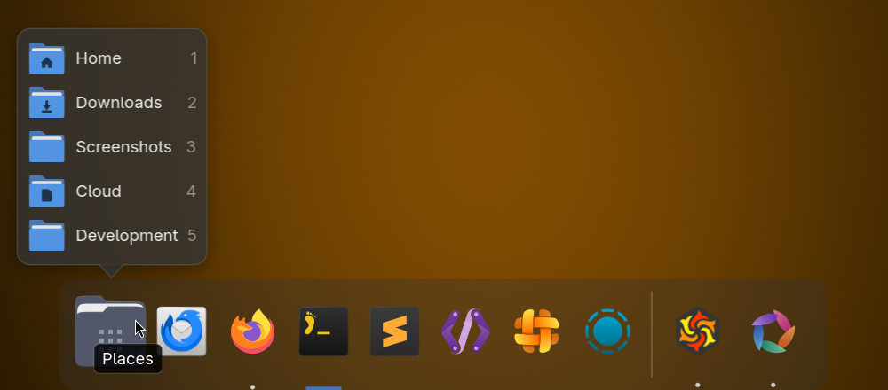
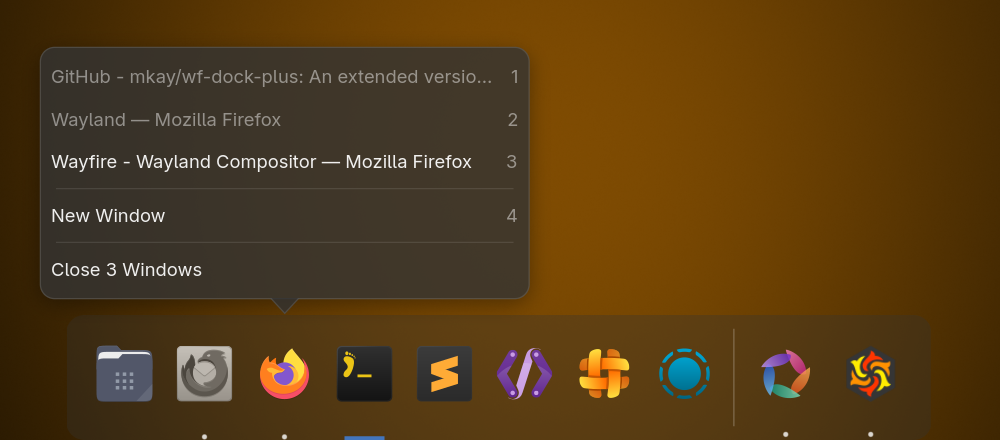

# wf-dock-plus

A dock for [Wayfire](https://github.com/WayfireWM/wayfire), based on `wf-dock` from [wf-shell](https://github.com/WayfireWM/wf-shell) and extended with pinned launchers, app grouping and a places menu.

wf-dock-plus is an unofficial project. It is not affiliated with or endorsed by the Wayfire or wf-shell developers, so please don't report its bugs to them. It installs next to wf-shell and doesn't replace any of its programs.





## Features

- **Pinned launchers** left of the running apps, separated by a thin line. Entries are desktop file ids, absolute paths to `.desktop` files, or custom launchers with their own command, icon and label.
- **App grouping, like the macOS Dock:** windows of a pinned app go into its launcher instead of getting an icon of their own, and every other app gets one icon, however many windows it has. Windows match a launcher by desktop file id, `StartupWMClass` or the launcher name; other app ids can be added per launcher.
  - **Click** starts the app, brings its last used window to the front, or cycles through its windows. Clicking a focused app with a single window minimizes it.
  - **Middle click** opens a new window, also for single-instance apps like Nautilus. It uses the desktop file's `new-window` action, or else the running app's `app.new-window` action over D-Bus (what Ctrl+Shift+N runs), or else starts the app again.
  - **Right click or a long press** lists the app's windows, with "New Window" and, last, "Close Window" / "Close N Windows", which asks every window to close like its close button. Keys 1–9 pick an entry, except the close one.
- **Pin, reorder and unpin by dragging:** drag a running app among the launchers to pin it there, drag a launcher to move it, and drag a launcher past the separator or out of the dock to remove it. A bar shows where the app will land, and a launcher fades when letting go would remove it.
- **Places button** left of the launchers, with a popover of folders: home, any paths or URIs, and the GTK bookmarks. A middle click opens the first one.
- **Minimize into the dock:** minimizing and restoring animate the window into and out of its dock icon, with Wayfire's minimize animation.
- **Autohide** at any screen edge, and a launch bounce when a launcher starts an app.
- **Icons:** running apps prefer their `.desktop` icon, more window icons are resolved than in wf-dock, and `~` works in icon paths.
- **Configured with WCM** on its own page; changes apply without restarting the dock.

## Requirements

Made for Wayfire. Also runs on stacking compositors with layer-shell and wlr foreign-toplevel support, such as labwc, but without autohide. Not on GNOME or KDE.

On Wayfire, autohide needs the `wayfire-shell` plugin, which wf-shell needs as well.

## Installing

On Arch Linux, install [wf-dock-plus](https://aur.archlinux.org/packages/wf-dock-plus) from the AUR, for example with an AUR helper:

```
yay -S wf-dock-plus
```

### Building from source

Build dependencies: meson, a C++17 compiler, `wayland-scanner`, gtkmm-4.0 (4.12 or later), gtk4-layer-shell, wayland-client and [wf-config](https://github.com/WayfireWM/wf-config). Wayfire itself isn't needed: the one Wayfire protocol the dock uses is bundled in `proto/`.

```
meson setup build --prefix=/usr --sysconfdir=/etc
meson compile -C build
sudo meson install -C build
```

The WCM page has to go to `/usr/share/wf-shell/metadata/`, where WCM looks for it, so install with the `/usr` prefix.

To try changes on Arch, `pkg/PKGBUILD` builds a package from the checkout it lives in, including uncommitted changes:

```
cd pkg
makepkg -f
sudo pacman -U wf-dock-plus-*.pkg.tar.*
```

## Running

Start `wf-dock-plus` at login from Wayfire's autostart. In WCM, open the **Autostart** page in the General category and add `wf-dock-plus` as a command (and remove `wf-dock` if you don't want two docks). In `~/.config/wayfire.ini` that is:

```ini
[autostart]
dock = wf-dock-plus
```

`wf-dock-plus --config <file>` reads another config file, and `--css <directory>` another CSS directory.

## Configuration

The dock reads the `[dock-plus]` section of `~/.config/wf-shell.ini`, the file wf-shell uses, and reloads it whenever the file changes. In WCM it is the **Dock Plus** page in the Shell category. `wf-dock-plus.ini.example` shows every option.

Pinning, moving and unpinning by dragging changes only the `launchers` line of that section. WCM doesn't notice the change while it is open, and its next save writes back the launchers it loaded, so close WCM before rearranging the dock, or reopen it afterwards.

WCM drops options it doesn't know whenever it saves `wf-shell.ini`, on any page. That includes `icon_mapping_<app_id>`, which sets an icon for an app that doesn't provide one; if you use WCM, give the app a `.desktop` file with an icon instead.

## Styling

The dock loads, in this order, its default stylesheet from `/usr/share/wf-dock-plus/css/default.css`, every `.css` file in `~/.config/wf-dock-plus/css/`, and the file named in the `css_path` option. CSS files in that directory reload as soon as they change.

The dock window has the `wf-dock` class, so stylesheets written for wf-shell's dock work unchanged. App buttons have the `running` class while the app has windows, `multiple` with more than one window, `activated` while one of them has focus, and `minimized` while all of them are minimized. The launch bounce is the `launch-bounce` animation. `examples/dock-indicator.css` replaces the focused app's underline with a short bar in the GTK theme's accent color (`@accent_bg_color`, which Adwaita-based themes define) and greys out minimized apps.

## Moving from wf-dock

1. Copy the `[dock]` section of `~/.config/wf-shell.ini` and rename the copy to `[dock-plus]`. Every wf-dock option works the same.
2. Copy your dock CSS from `~/.config/wf-shell/css/` to `~/.config/wf-dock-plus/css/`.
3. Replace `wf-dock` with `wf-dock-plus` in the Wayfire autostart.

## History and credits

wf-dock-plus was extracted from [WayfireWM/wf-shell](https://github.com/WayfireWM/wf-shell), keeping the git history of the extracted files. Commits up to `a6c1160` come from before the extraction and were made in wf-shell. The wf-shell code is by Ilia Bozhinov, Scott Moreau, trigg and the other wf-shell contributors.

New code in this project was written with the help of an AI assistant (Claude).

## License

MIT, like wf-shell. See `LICENSE`.
